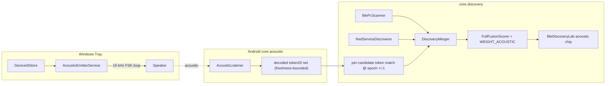

# SpaceDrop Architecture Review — 2026-07-08

**Purpose:** Read-only assessment before Step 3 (integrating the fixed Tier 0 acoustic
decoder into the main apps). Produced as Step 2 of the combined implementation task.
This document changes no code; it ends with a concrete, followed recommendation for Step 3.

**Scope reviewed:** `android/app/` discovery + transfer + UI layers, the Tier 0 POC
(`tools/tier0-acoustic-poc/`), and the Windows tray (`windows/SpaceDrop.Tray/`).

---

## 1. Current `android/app/` module structure

The app is a **single Gradle module** (`android/settings.gradle.kts` only `include(":app")`)
with a package-based internal layering under `com.prototype.airdrop`:

| Layer | Package | Key types |
|-------|---------|-----------|
| Discovery (fusion) | `core/discovery/` | `FusedNearbyDeviceRepository`, `DiscoveryMerger`, `FullFusionScorer`, `FusionBreakdown`, `DeviceRanking`, `DeviceUsageStore` |
| Connectivity (signal sources) | `core/connectivity/` + `core/connectivity/ble/` | `NsdServiceDiscoverer` (mDNS), `BlePcScanner`, `BlePermissions`, `WifiNetworkSnapshot`, `DeviceIdStore` |
| Transfer | `core/transfer/` + `core/connectivity/` | `TransferEngine`, `TcpTransferEngine`, `SpaceDropFileSender` |
| Models | `core/model/` | `NearbyDevice`, `TrustState`, `ProximityState`, `TransferModels` |
| Mock / DI | `core/mock/` | `AppDependencies`, `AppState`, `MockNearbyDeviceRepository`, `FakeTransferEngine` |
| UI | `ui/screens/`, `ui/components/` | Compose screens + orbital radar components |
| Navigation | `navigation/` | `AppNavGraph`, `Routes` |

### Separation verdict

The discovery pipeline is **cleanly layered and already fusion-shaped**, which is the
important finding for Step 3:

```
BlePcScanner ─┐
              ├─► DiscoveryMerger.merge() ─► List<MergedDiscoveryCandidate>
NsdServiceDiscoverer ─┘                              │
                                                     ▼
                          FullFusionScorer.scoreAll() ─► List<Pair<NearbyDevice, FusionBreakdown>>
                                                     │
                                                     ▼
                          DeviceRanking.rank() ─► List<RankedNearbyDevice>
```

Signal sources (BLE, mDNS) are already **collapsed into a single neutral value type**
(`MergedDiscoveryCandidate`) before scoring, and scoring is a **pure `object`** with no I/O.
This is the seam a third signal source (acoustic) should plug into.

Weaker separation exists in two places, neither blocking:
- **UI ↔ mock coupling:** `AppDependencies` exposes both real (`fusedNearbyDeviceRepository()`,
  `tcpTransferEngine()`) and mock (`mockRepository`, `fakeTransferEngine`) graphs. Home/picker
  use real; Pairing/SavedDevices/Diagnostics still use mock. This is fine for now (Step 4 audits it).
- **`AppState` global singleton** carries share/transfer nav state (see §3).

---

## 2. Can `fsk-core` drop into `android/` without restructuring fusion?

**Yes** — with one packaging caveat and one small additive change to the candidate type.

### The library is Android-safe
`tools/tier0-acoustic-poc/kotlin/fsk-core/build.gradle.kts` applies only
`org.jetbrains.kotlin.jvm`, package `com.spacedrop.tier0.fsk`, no Android/JVM-only APIs beyond
`java.security.MessageDigest` and arrays. Its public surface is exactly what a consumer needs:
`FskDecoder.process(ShortArray, count): List<FskFrame>` + `reset()`, `FskEncoder`,
`AcousticToken.computeToken20(deviceId, epoch)` / `epochFromUnixSeconds(...)`, `Crc4`.

### Packaging caveat (must handle in Step 3a)
`android/settings.gradle.kts` uses `dependencyResolutionManagement { repositoriesMode.set(FAIL_ON_PROJECT_REPOS) }`
and a restricted `pluginManagement` block. The app module applies the Kotlin **Android** plugin;
`fsk-core` applies the Kotlin **JVM** plugin. Adding `fsk-core` as
`include(":fsk-core")` + `implementation(project(":fsk-core"))` works, but the JVM plugin version
must resolve from the same version catalog/pluginManagement the app already uses (the app pins
Kotlin via the Android plugin). Recommended: apply `org.jetbrains.kotlin.jvm` with the **same
Kotlin version** the app uses, and keep `fsk-core`'s `jvmToolchain` compatible with the app's
`JavaVersion.VERSION_17` (the POC uses toolchain 21 — align to 17 for the main app or ensure the
toolchain is available). This is a build-config detail, not a source change.

### Fusion pipeline needs only an additive field, not a refactor
`DiscoveryMerger` already resolves candidates by `deviceId` (and host fallback). Acoustic
corroboration is keyed by the **same `deviceId`** (the token is `SHA-256(deviceId || epoch)` →
20 bits). So the acoustic result is a `Set<String>` of matched device IDs that can be applied to
`MergedDiscoveryCandidate` by adding one nullable/boolean field. `FullFusionScorer.score()` then
reads that field and adds a weight term. **No structural change** to `FusedNearbyDeviceRepository`,
`DiscoveryMerger.merge()`, or the scoring call site is required — only:
1. add `acousticTokenMatch: Boolean = false` to `MergedDiscoveryCandidate`,
2. apply matches after merge (one `.map { }` in `refreshInternal`), and
3. add a weight branch + `FusionBreakdown` field.

---

## 3. Fragile areas — prerequisite vs nice-to-have for Step 3

Step 3 adds an **always-listening audio subsystem** (mic capture + decoder) with the same
lifecycle shape as BLE. Assessed against the known-fragile areas:

### 3.1 `FusedNearbyDeviceRepository.scope` never cancelled — NICE-TO-HAVE (not a prerequisite)
`private val scope = CoroutineScope(SupervisorJob() + Dispatchers.Default)` is created per repo
instance. `stopDiscovery()` cancels `periodicJob` only, never `scope`. Because the repo is an
**app-lifetime singleton** (`AppDependencies.fusedNearbyDeviceRepository`), the scope living for the
whole process is benign today. Step 3's acoustic listener should **not** reuse this scope; it should
own its own capture job and follow the Step 1 teardown pattern (`cancelAndJoin()` + per-session
`AudioRecord`). So this leak is not made worse by Step 3. **Recommend:** leave as-is; optionally add
a `close()` if/when the repo becomes non-singleton.

### 3.2 `TcpTransferEngine.scope` never cancelled — NICE-TO-HAVE (relevant to Step 6, not Step 3)
`private val scope = CoroutineScope(Dispatchers.IO)`; only `transferJob` is cancelled. Also singleton.
Not touched by Step 3. Step 6 (multi-file) should reuse the same `transferJob` model (one job for the
whole batch). **Recommend:** address opportunistically in Step 6, not a blocker.

### 3.3 `BlePcScanner.inFlightAddresses` unsynchronized `mutableSetOf` — NICE-TO-HAVE
This dedupes concurrent GATT connects and is confined to BLE callbacks. Acoustic capture does not
touch it. Independent of Step 3. **Recommend:** defer.

### 3.4 `AppState` unsynchronized global mutable singleton — NICE-TO-HAVE
Holds `pendingTransferItems`, `selectedDevice`, `isFromShareSheet`, `shareRequestId`. Written from
`MainActivity` (main thread) and read from ViewModels; effectively main-thread-confined today.
Acoustic listener does not read/write it. **Recommend:** defer; revisit in Step 6 when multi-file
`pendingTransferItems` flows through it.

### Overall verdict
**None of the four fragile areas is a prerequisite for Step 3.** The reason is that the acoustic
subsystem is designed to be *self-contained* (owns its own scope + `AudioRecord`, exposes a pure
snapshot to fusion) rather than sharing the existing scopes/state. Forcing these fixes first would
expand Step 3's blast radius without reducing its risk. They are logged here and remain candidates
for Step 6 / a later hardening pass.

---

## 4. Recommended Step 3 integration approach (to be followed)

### 4.1 Module boundary
- Add `fsk-core` as a Gradle module to `android/` (`include(":fsk-core")`, project dir remapped to
  `../tools/tier0-acoustic-poc/kotlin/fsk-core`, `implementation(project(":fsk-core"))`), aligning the
  Kotlin JVM plugin version and toolchain to the app (§2 caveat).
- New package **`com.prototype.airdrop.core.acoustic`** holding all acoustic code, mirroring the
  `core/connectivity/ble/` structure so it reads as a peer signal source:
  - `AcousticListener` — a hardened port of the POC `AudioToneListener` (per-session `AudioRecord`
    ownership, `cancelAndJoin()` teardown from Step 1, `UNPROCESSED` source, 2048-sample reads,
    feeds `FskDecoder.process()`).
  - `AcousticPermissions` — mirrors `BlePermissions` for `RECORD_AUDIO`.
  - `AcousticTokenMatcher` — the fusion-facing interface (below).

### 4.2 Interface exposed to fusion
Keep the acoustic subsystem decoupled from scoring via a **snapshot of recently matched device IDs**:

```kotlin
// core/acoustic/AcousticCorroborationSource.kt
interface AcousticCorroborationSource {
    /** Device IDs whose token was decoded within the freshness window, at current epoch or +/-1. */
    fun matchedDeviceIds(): Set<String>
}
```

- `AcousticListener` implements it. It keeps a small time-bounded map of
  `decodedToken20 -> lastHeardMs` (e.g. 6 s freshness).
- Matching is done **at the candidate level**: for each `MergedDiscoveryCandidate`, compute
  `AcousticToken.computeToken20(candidate.deviceId, epoch)` for `epoch`, `epoch-1`, `epoch+1`
  (clock-skew tolerance, epoch = 30 s) and check membership in the decoded-token set. This is why
  the interface returns device IDs the *matcher already resolved* OR (simpler) returns the raw
  decoded token set and the merge step resolves per-candidate. **Chosen:** matcher owns the raw
  decoded-token set + freshness; the repository resolves per-candidate tokens (it already iterates
  candidates in `refreshInternal`). This keeps `fsk-core` and candidate iteration in one place.

### 4.3 Wiring into the repository (minimal, additive)
In `FusedNearbyDeviceRepository.refreshInternal()`, after `DiscoveryMerger.merge(...)` and before
`FullFusionScorer.scoreAll(...)`, map each candidate to set `acousticTokenMatch` using the acoustic
source. `AcousticListener` is started/stopped alongside periodic refresh
(`startPeriodicRefresh`/`stopDiscovery`) but on its **own** scope/job, gated on `RECORD_AUDIO`.

### 4.4 Fusion scoring change
Add `WEIGHT_ACOUSTIC` to `FullFusionScorer` and `acousticWeight` to `FusionBreakdown`. Acoustic is a
**corroboration-only boost**: it applies only when the candidate already has BLE or mDNS
(`candidate.hasBle || candidate.hasMdns`) — it can never lift a phantom into existence, and
`scoreAll`'s existing pre-filter guarantees acoustic-only candidates never appear (there is no
acoustic-only candidate; acoustic never enters `DiscoveryMerger`). Rebalance so the max stays 1.0
(current terms already sum to 1.0); record before/after constants + reasoning in `PROGRESS.md`.

### 4.5 Lab visibility + Windows emitter
- Add an "acoustic" chip to `BleDiscoveryLabScreen` (token-match status) using the existing chip
  pattern and the new `FusionBreakdown.acousticWeight`.
- Windows: fold a background FSK emitter into `SpaceDrop.Tray` reusing the C# `SpaceDrop.AcousticFsk`
  lib + `AudioOutputSelector`/`FskLoopWaveProvider`, token from tray `DeviceIdStore`, epoch from wall
  clock, continuous ~3.2 s loop.



### 4.6 Non-negotiable invariants (carried into Step 3)
1. Acoustic **never** creates a device row — corroboration only.
2. No false match when the PC is silent/out of range (freshness window + CRC-valid frames only;
   `FskDecoder` already returns only CRC-valid frames).
3. Acoustic listener owns its lifecycle; does not reuse repo/transfer scopes.
4. Weight constants changed only with a logged before/after in `PROGRESS.md`.

---

## 5. Summary

- The discovery pipeline is already fusion-shaped; acoustic is an **additive third source**, not a
  refactor. `MergedDiscoveryCandidate` + `FullFusionScorer` are the exact insertion points.
- `fsk-core` drops in as a Gradle module; only build-config alignment (Kotlin JVM plugin version +
  toolchain) needs care.
- All four fragile areas are **nice-to-have, not prerequisites**, because the acoustic subsystem is
  self-contained by design.
- Step 3 proceeds per §4.
